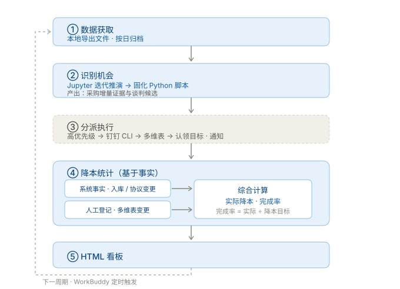

# 供应链降本管理

面向采购降本管理的数据分析项目：围绕采购降本的全生命周期流程，从**数据获取**、**识别降本机会**、**降本执行与追踪跟进**，到**降本核算与统计**，形成可持续运转的业务闭环。

## 全生命周期流程



| 环节 | 内容 | 状态 |
| --- | --- | --- |
| ① 数据获取 | 读取上游导出的采购入库文件，原样归档 | 已实现 |
| ② 识别机会 | 采购增量分析，识别采购量增长信号，产出谈判候选清单 | 已实现 |
| ③ 分派执行 | 谈判候选分派给采购员，跟进执行与反馈 | 业务方案（见 [分派与反馈](分派与反馈.md)） |
| ④ 降本统计 | 基于事实核算实际降本，输出统计报告和看板 | 方案已确认（见 [采购降本自动化核算方案](notebooks/采购降本统计/采购降本自动化核算方案.md)） |

## 分析场景

**场景是本项目的一等单元**：一个场景 = 一个可复跑的分析产品，方案确认与研究验证在 `notebooks/<场景>/`，稳定代码在 `src/`，入口在 `scripts/`。每个场景一份 `分析方案.md` 从第一步写到第五步（五节追加式，见 [模板](.agents/skills/data-ana/templates/分析方案.md)；存量方案文档下次动工时并入）。

| 场景 | 状态 | 入口 | 交付物 |
| --- | --- | --- | --- |
| [采购增量分析](notebooks/采购增量分析/采购增量分析.md) | 已落地 | `uv run python scripts/run_analysis.py` | `outputs/reports/…采购增量分析报告.xlsx`（谈判候选四档） |
| [采购降本统计](notebooks/采购降本统计/采购降本自动化核算方案.md) | 方案已确认 | 待落地（DDL + 核算脚本） | 月度降本统计报表（六类核算口径） |

`notebooks/数据清洗/` 是数据源级共享工作区（不属于任何场景）：接入方案与清洗研究放这里，产出被所有场景复用。

新增分析场景：按 [分析方案模板](.agents/skills/data-ana/templates/分析方案.md) 建文档，从第一步（业务理解与指标构建）开始；五步方法见 [data-ana SKILL.md](.agents/skills/data-ana/SKILL.md)。

## 目录组织

```text
scm-ana/
├── README.md
├── pyproject.toml                 # 项目元数据、依赖与 hatchling 构建配置
├── uv.lock / .python-version      # 依赖锁定（进版本库）/ 固定 Python 3.12
├── .local-data/                   # 上游导出的入库明细 Excel（不进版本库）
├── notebooks/                     # 按场景组织：方案确认 + 研究验证
│   ├── 采购增量分析/               #   方案 md + 验证 notebook
│   ├── 采购降本统计/               #   核算方案 md + 数据模型 md
│   └── 数据清洗/                  #   数据源级共享：接入方案 + 清洗研究 notebook
├── .agents/skills/data-ana/       # data-ana 技能（ZCode 自动发现；五步法）
│   ├── SKILL.md                   #   进入方式 + 三条铁律 + 五步路由
│   ├── references/                #   各步方法：01~04 已定，05 随场景推进补齐
│   └── templates/                 #   分析方案 / 数据清洗模版 / 指标验证模版
├── src/                           # 代码分层：与场景解耦的引擎
│   ├── paths.py                   # 项目路径与上海时区
│   ├── archive.py                 # 存储层：parquet 归档的路径规则与读写
│   ├── read_data.py               # 取数门面：read_inbound(start, end, columns)
│   ├── pipeline.py                # 流水线：analyze()，取数 → 分析 → 导出
│   ├── sources/procurement_inbound.py  # 数据源层：口径 + 取数 + Excel 导入（一来源一模块）
│   ├── analysis/procurement_increment.py  # 分析层：一场景一模块（Config + run_analysis + export）
│   └── reporting/excel.py         # 导出层：Excel 报告
├── scripts/
│   ├── sync_data.py               # 导入入口：Excel 导出 → raw 日档
│   └── run_analysis.py            # 分析入口：跑增量分析、导报告
├── tests/                         # 离线测试：test_archive / test_inbound / test_increment
├── data/
│   ├── raw/                       # 来源文件原样归档，按来源和业务日存放
│   └── processed/                 # 清洗底表（清洗规则确认后由 src/clean 落地写入）
└── assets/                        # 文档图示
```

`src/` 下直接放 Python 模块，由 `uv sync` 以 editable 方式装进 `.venv`，脚本和 notebooks 直接 `import read_data`，不修改 `sys.path`。新增分析从 notebook 开始，业务确认后提取到 `src/`。

## 按日归档

```text
data/raw/procurement-inbound/2026/2026-10/2026-10-25/data.parquet
data/processed/procurement-inbound/2026/2026-10/2026-10-25/data.parquet
```

路径统一为 `data/<层>/<来源>/<YYYY>/<YYYY-MM>/<YYYY-MM-DD>/data.parquet`，一天一个业务日期。
raw 是来源文件的原样转换：列名、取值和单位都不动，只追加 `_source` 和 `_fetched_at` 两列元数据。
清洗由业务侧单独处理，底表写入 `data/processed/`；分析优先读底表，没有底表时直接读 raw。

目录日期 = 记录里的「出入库日期」；节假日没有入库就没有文件。同一业务日重复归档原子替换当天文件。

## 快速开始

环境由 uv 管理：Python 版本固定在 `.python-version`（3.12），依赖锁在 `uv.lock`，`uv sync` 会建好 `.venv`
并以 editable 方式装上本项目的 `src/`。

```bash
uv sync          # 首次或 pyproject 变更后执行，含 dev 组（jupyterlab、ipykernel）

# 分析直接读 data/raw 的日档 parquet，无需上游文件
uv run python scripts/run_analysis.py
```

查看归档、只跑数不落文件：

```bash
uv run python scripts/sync_data.py --list
uv run python scripts/run_analysis.py --start-date 2025-10-01 --end-date 2026-09-30 --dry-run
```

取数就一句，返回 DataFrame。参数个数决定语义，参数精度决定粒度：

```python
from read_data import read_inbound

read_inbound("2026-09-30")          # 一天
read_inbound("2026-09")             # 一个月
read_inbound("2026")                # 一年
read_inbound("2026-01", "2026-09")  # 一个范围，两边都含
read_inbound(columns=["出入库日期", "数量"])   # 全部日期 + 列裁剪
```

`--start-date` / `--end-date` 选择取数窗口（写法和 `read_inbound` 一致），`--end-month` 选择业务结束月，
`--window-months` 决定分析窗口长度。报告写入 `outputs/reports/<业务结束日>/`，内容包含数据文件与转换时间。

使用 notebooks（`uv sync` 已装好 jupyterlab 和 ipykernel）：

```bash
uv run python -m ipykernel install --user --name scm-ana --display-name 'scm-ana'
uv run jupyter lab notebooks/采购增量分析/采购增量分析.ipynb
```

在 Jupyter 或 VS Code 中选择 `scm-ana` 内核（不要选其他环境的内核，否则导入不到 `read_data`）。离线验证：

```bash
uv run python -m unittest discover -s tests -t tests
```

## 文档

| 内容 | 位置 |
| --- | --- |
| 采购增量分析：口径与报表字段 / 研究验证 | [方案](notebooks/采购增量分析/采购增量分析.md) · [验证 notebook](notebooks/采购增量分析/采购增量分析.ipynb) |
| 采购降本统计：核算方案 / 数据模型 | [核算方案](notebooks/采购降本统计/采购降本自动化核算方案.md) · [数据模型](notebooks/采购降本统计/采购降本核算数据模型.md) |
| 数据接入与清洗方案（数据源级，含新增来源指引） | [采购入库接入及清洗](notebooks/数据清洗/采购入库接入及清洗.md) · [清洗研究](notebooks/数据清洗/采购入库数据清洗.ipynb) |
| 数据分析技能方法论（五步法 + 三条铁律） | [data-ana SKILL.md](.agents/skills/data-ana/SKILL.md) |
| 技能设计思路调研 | [数据分析技能设计思路调研](数据分析技能设计思路调研.md) |
| 分派反馈规划 | [分派与反馈](分派与反馈.md) |
