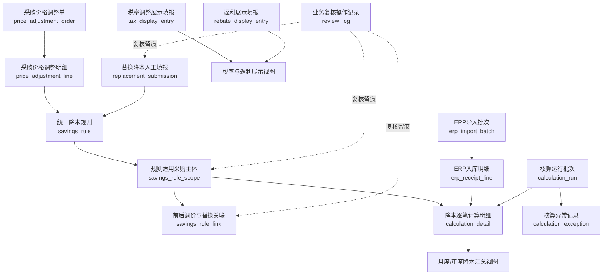

# 采购降本核算 — 数据模型与全表字段设计

*第一阶段建议稿  |  V1.0  |  2026年10月28日*

定位：可直接用于数据库表结构评审与脚本开发拆分；明确区分“业务已确认规则”和“技术建议设计”。

适用范围：直接涨跌自动核算；渠道/品牌/规格替换人工填报基础信息、ERP提取数量、脚本统一计算；税率调整和返利独立填报仅展示。

## 01  设计边界与关键原则

| 项目 | 当前口径 / 建模原则 |
| --- | --- |
| ERP事实数据 | 仅7个业务字段：主体、供应商、物料、含税单价、税率、数量、日期。导入批次和行序号属于系统元数据，不是新增ERP业务字段。 |
| 核算依据 | 直接涨跌使用采购价格调整单明细；替换涨跌使用钉钉多维表人工填报的基础量价和换算关系。 |
| 适用主体 | 集团统一价格；采购员复核确认适用主体；规则按主体展开后与ERP入库匹配。 |
| 周期 | 每条调价/替换明细独立12个自然月，由价格生效日期推算。 |
| 多次调价 | 固定本次增量差额；后续低价入库可支持历史未到期规则；跨类型“替换→直接降价”同样适用。 |
| 口径 | 含税单价。品牌/规格使用可比单位换算；渠道替换无换算。 |
| 汇总 | 新增/存量仅按自然年度区分；税率、返利展示但不参与降本总额。 |
| 复核 | 自动识别价格关系，歧义交采购员；人工填报经业务复核和程序校验后入正式汇总。 |

> 本文件的表名、主键、索引和技术字段均是实施建议，并非采购规则原文定义。对于年末起算、负向金额、红冲及舍入精度等仍保留待确认。

## 02  表关系总览

> 关系图为逻辑示意。核心是：采购调整单/替换填报 → 标准降本规则 → 适用主体及前后关系 → ERP逐笔计算 → 汇总视图。税率、返利不进入计算明细。

## 03  全部表目录（14张）

| 序号 | 物理表名 | 中文名称 | 层次 |
| --- | --- | --- | --- |
| 01 | erp_import_batch | ERP导入批次 | 数据接入 |
| 02 | erp_receipt_line | ERP入库明细 | 数据接入 |
| 03 | price_adjustment_order | 采购价格调整单 | 业务来源 |
| 04 | price_adjustment_line | 采购价格调整单明细 | 业务来源 |
| 05 | replacement_submission | 替换降本人工填报 | 业务来源 |
| 06 | tax_display_entry | 税率调整展示填报 | 展示来源 |
| 07 | rebate_display_entry | 返利展示填报 | 展示来源 |
| 08 | savings_rule | 统一降本规则 | 标准化 |
| 09 | savings_rule_scope | 规则适用采购主体 | 标准化 |
| 10 | savings_rule_link | 连续调价/替换关联 | 关系识别 |
| 11 | calculation_run | 核算运行批次 | 计算 |
| 12 | calculation_detail | 降本逐笔计算明细 | 计算 |
| 13 | calculation_exception | 核算异常记录 | 复核 |
| 14 | review_log | 业务复核操作记录 | 复核 |

> 说明：月度汇总、年度汇总建议先采用查询视图，不额外持久化宽表。公司、供应商、物料在第一版直接引用来源编码，不重复建立主数据表。

## 04  全表字段字典

### 01 erp_import_batch  ERP导入批次

> 物理表：erp_import_batch  |  入口表；记录文件或周期快照，解决重复导入与追溯

| 字段 | 类型（建议） | 必填 | 说明 / 规则 |
| --- | --- | --- | --- |
| id | uuid | 是 | 批次主键 |
| source_name | varchar(100) | 是 | ERP数据来源标识 |
| source_period | char(7) | 是 | 数据覆盖月份，例2026-07 |
| snapshot_mode | varchar(16) | 是 | full_snapshot / incremental；第一版推荐整月快照 |
| file_fingerprint | varchar(64) | 是 | 原始文件内容摘要，用于重导检测 |
| row_count | integer | 否 | 文件数据行数 |
| import_status | varchar(20) | 是 | uploaded / validated / active / replaced / failed |
| imported_at | timestamp | 是 | 导入时间 |
| remark | text | 否 | 来源说明 |

主键 / 约束：PK(id)；unique(source_name, source_period, file_fingerprint) 建议；同一月份只允许一份当前有效完整快照。

业务规则：同月重新导出时应替换有效快照，不能把新旧全量数据叠加计数。

### 02 erp_receipt_line  ERP入库明细

> 物理表：erp_receipt_line  |  ERP事实表；7个业务字段 + 3个系统定位字段

| 字段 | 类型（建议） | 必填 | 说明 / 规则 |
| --- | --- | --- | --- |
| id | uuid | 是 | 入库行系统主键 |
| batch_id | uuid | 是 | FK → erp_import_batch.id |
| row_no | integer | 是 | 源文件行序号（系统元数据） |
| company_code | varchar(80) | 是 | 采购主体【ERP字段1】 |
| supplier_code | varchar(80) | 是 | 供应商【ERP字段2】 |
| material_code | varchar(80) | 是 | 物料【ERP字段3】 |
| gross_unit_price | numeric(20,6) | 是 | 含税单价【ERP字段4】 |
| tax_rate | numeric(9,6) | 是 | 税率【ERP字段5】，示例0.13 |
| quantity | numeric(20,6) | 是 | 入库数量【ERP字段6】 |
| receipt_date | date | 是 | 入库日期【ERP字段7】 |

主键 / 约束：PK(id)；unique(batch_id,row_no)；索引(company_code,supplier_code,material_code,receipt_date,gross_unit_price)。

业务规则：七字段相同的两行可能是真实两次入库，不可按七字段值去重；只按来源批次及行序号识别。

### 03 price_adjustment_order  采购价格调整单

> 物理表：price_adjustment_order  |  单据头；来源工作流同步

| 字段 | 类型（建议） | 必填 | 说明 / 规则 |
| --- | --- | --- | --- |
| id | uuid | 是 | 系统主键 |
| source_order_no | varchar(100) | 是 | 采购价格调整单号 |
| source_system | varchar(50) | 是 | 来源系统 / 钉钉同步标识 |
| source_updated_at | timestamp | 否 | 来源修改时间 |
| synced_at | timestamp | 是 | 同步到系统时间 |
| document_status | varchar(20) | 是 | 有效 / 撤回 / 作废等标准状态 |
| remark | text | 否 | 说明 |

主键 / 约束：PK(id)；unique(source_system,source_order_no)。

业务规则：明确使用“采购价格调整单”，不再使用此前的“审批单”作为业务实体名称。

### 04 price_adjustment_line  采购价格调整单明细

> 物理表：price_adjustment_line  |  直接涨跌的原始价格规则来源

| 字段 | 类型（建议） | 必填 | 说明 / 规则 |
| --- | --- | --- | --- |
| id | uuid | 是 | 明细主键 |
| order_id | uuid | 是 | FK → price_adjustment_order.id |
| source_line_no | varchar(80) | 是 | 单据内行标识 |
| supplier_code | varchar(80) | 是 | 供应商 |
| material_code | varchar(80) | 是 | 物料 |
| old_gross_price | numeric(20,6) | 是 | 调整前含税单价 |
| new_gross_price | numeric(20,6) | 是 | 调整后含税单价 |
| price_effective_date | date | 是 | 价格生效日；据此生成12个月周期 |
| line_status | varchar(20) | 是 | active / canceled |
| synced_at | timestamp | 是 | 同步时间 |

主键 / 约束：PK(id)；unique(order_id,source_line_no)；索引(supplier_code,material_code,price_effective_date)。

业务规则：一个单据头多条明细；每条明细单独生成一条标准降本规则与独立周期。

### 05 replacement_submission  替换降本人工填报

> 物理表：replacement_submission  |  渠道/品牌/规格统一一张人工表

| 字段 | 类型（建议） | 必填 | 说明 / 规则 |
| --- | --- | --- | --- |
| id | uuid | 是 | 填报记录ID（钉钉行ID可做外部键） |
| source_record_id | varchar(120) | 是 | 钉钉多维表记录标识 |
| replacement_type | varchar(20) | 是 | channel / brand / specification |
| old_supplier_code | varchar(80) | 是 | 原供应商 |
| new_supplier_code | varchar(80) | 是 | 新供应商 |
| old_material_code | varchar(80) | 是 | 原物料；渠道替换应与新物料相同 |
| new_material_code | varchar(80) | 是 | 新物料 |
| old_gross_price | numeric(20,6) | 是 | 原含税单价 |
| new_gross_price | numeric(20,6) | 是 | 新含税单价 |
| old_purchase_unit | varchar(40) | 是 | 原计价单位 |
| new_purchase_unit | varchar(40) | 是 | 新计价单位 |
| comparable_unit | varchar(40) | 是 | 统一可比单位；渠道可等于采购单位 |
| old_unit_factor | numeric(20,8) | 是 | 每原采购单位折算成可比单位的数量；渠道为1 |
| new_unit_factor | numeric(20,8) | 是 | 每新采购单位折算成可比单位的数量；渠道为1 |
| price_effective_date | date | 是 | 替换价格生效日期 |
| evidence | text | 否 | 业务说明、依据链接或附件指针 |
| review_status | varchar(20) | 是 | draft / pending / approved / rejected |
| updated_at | timestamp | 是 | 填报最后更新时间 |

主键 / 约束：PK(id)；unique(source_record_id)；索引(new_supplier_code,new_material_code,price_effective_date)。

业务规则：采购员负责价格、可比关系、换算系数；执行数量不在表内手工填写，来自ERP。

### 06 tax_display_entry  税率调整展示填报

> 物理表：tax_display_entry  |  独立展示源，不参与降本计算明细

| 字段 | 类型（建议） | 必填 | 说明 / 规则 |
| --- | --- | --- | --- |
| id | uuid | 是 | 记录主键 |
| source_record_id | varchar(120) | 是 | 钉钉行ID |
| period_month | char(7) | 是 | 展示月份 |
| company_code | varchar(80) | 否 | 采购主体 |
| supplier_code | varchar(80) | 否 | 供应商 |
| material_code | varchar(80) | 否 | 物料 |
| old_tax_rate | numeric(9,6) | 否 | 原税率 |
| new_tax_rate | numeric(9,6) | 否 | 新税率 |
| display_amount | numeric(20,2) | 否 | 业务确认的税率影响展示金额 |
| remark | text | 否 | 说明/附件依据 |
| review_status | varchar(20) | 是 | 复核状态 |
| updated_at | timestamp | 是 | 最近同步时间 |

主键 / 约束：PK(id)；unique(source_record_id)。

业务规则：只展示，不参与新增/存量和总降本；展示金额的正负方向仍由业务最终明确。

### 07 rebate_display_entry  返利展示填报

> 物理表：rebate_display_entry  |  独立展示源，不参与降本计算明细

| 字段 | 类型（建议） | 必填 | 说明 / 规则 |
| --- | --- | --- | --- |
| id | uuid | 是 | 记录主键 |
| source_record_id | varchar(120) | 是 | 钉钉行ID |
| period_month | char(7) | 是 | 展示月份 |
| company_code | varchar(80) | 否 | 采购主体 |
| supplier_code | varchar(80) | 否 | 供应商 |
| rebate_type | varchar(40) | 否 | 季度/年度/阶梯/专项等 |
| confirmed_amount | numeric(20,2) | 是 | 确认返利金额 |
| evidence | text | 否 | 协议/结算依据 |
| review_status | varchar(20) | 是 | 复核状态 |
| updated_at | timestamp | 是 | 最后同步时间 |

主键 / 约束：PK(id)；unique(source_record_id)。

业务规则：第一阶段只拉取并展示人工确认金额，不自动根据协议测算。

### 08 savings_rule  统一降本规则

> 物理表：savings_rule  |  计算核心；将直接和替换两类来源标准化

| 字段 | 类型（建议） | 必填 | 说明 / 规则 |
| --- | --- | --- | --- |
| id | uuid | 是 | 规则主键；对应一条可独立核算的降本明细 |
| source_type | varchar(20) | 是 | direct / replacement |
| source_id | uuid | 是 | price_adjustment_line.id 或 replacement_submission.id |
| saving_type | varchar(20) | 是 | direct / channel / brand / specification |
| old_supplier_code | varchar(80) | 是 | 原采购方供应商 |
| new_supplier_code | varchar(80) | 是 | 新采购方供应商 |
| old_material_code | varchar(80) | 是 | 原物料 |
| new_material_code | varchar(80) | 是 | 新物料 |
| old_gross_price | numeric(20,6) | 是 | 原含税单价 |
| new_gross_price | numeric(20,6) | 是 | 新含税单价 |
| comparable_unit | varchar(40) | 是 | 可比单位；直接/渠道与采购计价单位一致 |
| old_unit_factor | numeric(20,8) | 是 | 每原采购单位可比数量；直接/渠道=1 |
| new_unit_factor | numeric(20,8) | 是 | 每新采购单位可比数量；直接/渠道=1 |
| unit_saving | numeric(24,10) | 是 | 旧可比单价－新可比单价，固定增量价差 |
| price_effective_date | date | 是 | 业务生效日 |
| period_start | date | 是 | 从生效日推算核算首日 |
| period_end | date | 是 | 12个月终止日，含当天 |
| rule_status | varchar(20) | 是 | pending / active / suspended / canceled |
| source_revision | varchar(80) | 否 | 对应源记录版本，支持重算追溯 |

主键 / 约束：PK(id)；unique(source_type,source_id)（如允许源版本并存则调整为复合版本键）；索引(new_supplier_code,new_material_code,period_start,period_end)。

业务规则：并非新业务单据，而是计算用的标准化投影。直接/渠道 unit_saving=原价−现价；品牌/规格先各自除以换算系数。

### 09 savings_rule_scope  规则适用采购主体

> 物理表：savings_rule_scope  |  集团规则分摊到具体采购主体；复核边界

| 字段 | 类型（建议） | 必填 | 说明 / 规则 |
| --- | --- | --- | --- |
| id | uuid | 是 | 主体规则主键 |
| rule_id | uuid | 是 | FK → savings_rule.id |
| company_code | varchar(80) | 是 | 该规则适用的采购主体 |
| review_status | varchar(20) | 是 | pending / approved / rejected |
| reviewed_by | varchar(80) | 否 | 采购员ID |
| reviewed_at | timestamp | 否 | 确认时间 |
| remark | text | 否 | 适用范围说明 |

主键 / 约束：PK(id)；unique(rule_id,company_code)；索引(company_code,review_status)。

业务规则：只有approved的主体范围参与正式计算；集团规则可适用多个主体，后续调价也可只覆盖部分主体。

### 10 savings_rule_link  前后调价与替换关联

> 物理表：savings_rule_link  |  价格链连接表；按采购主体确定继承关系

| 字段 | 类型（建议） | 必填 | 说明 / 规则 |
| --- | --- | --- | --- |
| id | uuid | 是 | 关系主键 |
| previous_scope_id | uuid | 是 | FK → savings_rule_scope.id；上一调整/替换 |
| next_scope_id | uuid | 是 | FK → savings_rule_scope.id；下一调整/替换 |
| link_type | varchar(20) | 是 | price_continuation / replace_to_direct |
| decision_source | varchar(20) | 是 | auto / manual |
| review_status | varchar(20) | 是 | approved / pending / rejected |
| reviewed_by | varchar(80) | 否 | 人工复核人 |
| reviewed_at | timestamp | 否 | 复核时间 |
| remark | text | 否 | 歧义与业务说明 |

主键 / 约束：PK(id)；unique(previous_scope_id,next_scope_id)；检查前后同一主体、时间顺序与无环链。

业务规则：自动识别：前一条现价≈后一条原价、采购关系连续、时间递进且候选唯一；跨类型关联允许“替换后直接降价”。不使用简单价格小于阈值判断。

### 11 calculation_run  核算运行批次

> 物理表：calculation_run  |  每次月度计算或重算一条记录

| 字段 | 类型（建议） | 必填 | 说明 / 规则 |
| --- | --- | --- | --- |
| id | uuid | 是 | 核算批次主键 |
| period_month | char(7) | 是 | 核算月份 YYYY-MM |
| status | varchar(20) | 是 | running / validated / published / failed / superseded |
| input_snapshot | text | 是 | ERP批次、调价及填报版本列表的摘要/JSON |
| rule_version | varchar(40) | 是 | 规则计算版本 |
| started_at | timestamp | 是 | 开始时间 |
| finished_at | timestamp | 否 | 结束时间 |
| published_at | timestamp | 否 | 正式发布时点 |
| created_by | varchar(80) | 否 | 操作者/任务ID |

主键 / 约束：PK(id)；同一月份仅一个published有效版本（数据库部分唯一索引或应用级发布控制）。

业务规则：同月重算生成新run，不覆盖历史明细；报表只取该月最新正式发布run。

### 12 calculation_detail  降本逐笔计算明细

> 物理表：calculation_detail  |  最重要的审计事实表：ERP行 × 适用主体规则

| 字段 | 类型（建议） | 必填 | 说明 / 规则 |
| --- | --- | --- | --- |
| id | uuid | 是 | 计算明细主键 |
| run_id | uuid | 是 | FK → calculation_run.id |
| receipt_line_id | uuid | 是 | FK → erp_receipt_line.id |
| rule_scope_id | uuid | 是 | FK → savings_rule_scope.id |
| period_month | char(7) | 是 | 归集月份 |
| saving_type | varchar(20) | 是 | 直接、渠道、品牌或规格 |
| year_category | varchar(12) | 是 | new / carried（新增/存量） |
| matched_gross_price | numeric(20,6) | 是 | 参与匹配的ERP含税单价 |
| erp_quantity | numeric(20,6) | 是 | 原ERP入库数量 |
| comparable_quantity | numeric(24,8) | 是 | ERP数量 × 本条规则的新换算系数 |
| unit_saving | numeric(24,10) | 是 | 固定可比单位降本；运行快照值 |
| saving_amount | numeric(24,6) | 是 | comparable_quantity × unit_saving |
| match_path | varchar(30) | 是 | direct_price / price_chain / cross_type_chain |
| calculated_at | timestamp | 是 | 计算时间 |

主键 / 约束：PK(id)；unique(run_id,receipt_line_id,rule_scope_id)；索引(run_id,period_month,year_category,saving_type)。

业务规则：允许同一入库行贡献多条不同规则，但同一run×入库行×主体规则只能一条；金额逐条保留高精度，报表最终再舍入。

### 13 calculation_exception  核算异常记录

> 物理表：calculation_exception  |  不影响其它正常数据的计算

| 字段 | 类型（建议） | 必填 | 说明 / 规则 |
| --- | --- | --- | --- |
| id | uuid | 是 | 异常主键 |
| run_id | uuid | 是 | FK → calculation_run.id |
| source_type | varchar(30) | 是 | rule / scope / link / receipt / replacement |
| source_id | varchar(120) | 是 | 发生异常的记录标识 |
| exception_code | varchar(50) | 是 | scope_unconfirmed / chain_ambiguous / price_unmatched / unit_invalid / duplicate_attribution |
| description | text | 是 | 异常说明 |
| status | varchar(20) | 是 | open / resolved / waived |
| reviewed_by | varchar(80) | 否 | 处理人 |
| resolved_at | timestamp | 否 | 解决时间 |

主键 / 约束：PK(id)；索引(run_id,status,exception_code)。

业务规则：未确认部分不能进入正式降本；确认后重新运行/重算得到正式结果，避免直接手工改计算金额。

### 14 review_log  业务复核操作记录

> 物理表：review_log  |  留痕表；涵盖主体、价格链、替换填报及展示项

| 字段 | 类型（建议） | 必填 | 说明 / 规则 |
| --- | --- | --- | --- |
| id | uuid | 是 | 复核日志主键 |
| object_type | varchar(30) | 是 | submission / scope / link / exception / tax / rebate |
| object_id | varchar(120) | 是 | 被复核记录ID |
| action | varchar(30) | 是 | submit / approve / reject / amend / reopen |
| reviewer_id | varchar(80) | 是 | 操作人 |
| action_at | timestamp | 是 | 发生时间 |
| comment | text | 否 | 复核原因/备注 |
| value_snapshot | text | 否 | 复核关键字段摘要/JSON（便于追溯） |

主键 / 约束：PK(id)；索引(object_type,object_id,action_at)。

业务规则：可先简化为业务复核留痕，后续需钉钉审批工作流时再与其操作记录关联。

## 05  表间关联与计算约束

### 5.1 主要一对多关系

| 父表 | 子表 | 关系 |
| --- | --- | --- |
| erp_import_batch | erp_receipt_line | 1:N；一次导入包含多条ERP入库行 |
| price_adjustment_order | price_adjustment_line | 1:N；一张价格调整单有多条调价明细 |
| price_adjustment_line / replacement_submission | savings_rule | 每条来源明细形成1条标准规则；source_type+source_id定位 |
| savings_rule | savings_rule_scope | 1:N；一条集团规则适用多个主体 |
| savings_rule_scope | savings_rule_link | 同主体的前后调价关联；允许多条规则形成历史链 |
| calculation_run | calculation_detail | 1:N；一次月度运行包含多条计算贡献 |
| erp_receipt_line / savings_rule_scope | calculation_detail | 通过计算明细建立多对多贡献关系 |

### 5.2 统一价格匹配规则

1. 先按采购主体、当前供应商、当前物料定位可能关联的标准规则及价格链。

2. 按照入库含税价识别当前实际执行价格；优先唯一等价匹配（金额比较允许统一精度处理）。

3. 只有已确认的前后关系可以向上追溯；在各自12个月周期内的前序规则继续贡献固定价差。

4. 替换→直接降价：新供应商/物料的后续入库既支持原替换规则的固定可比差额，也支持直接降价的增量差额。

5. 遇到多条候选且无法唯一识别、主体范围未批、单位不可比时，生成异常，不自动猜测。

### 5.3 计算公式与类型转换

| 类型 | 单次规则固定单位差额 | 用于计算的数量 |
| --- | --- | --- |
| 直接涨跌 | old_gross_price − new_gross_price | ERP入库数量 |
| 渠道替换 | old_gross_price − new_gross_price | 新渠道ERP入库数量 |
| 品牌替换 | old_gross_price/old_factor − new_gross_price/new_factor | 新品牌ERP数量 × new_factor |
| 规格替换 | old_gross_price/old_factor − new_gross_price/new_factor | 新规格ERP数量 × new_factor |

核算开始日：若价格生效日为当月1日，则取当月1日；否则取次月1日。核算结束日：开始日起满12个自然月的前一日。

新增/存量：核算月份所属自然年等于核算开始年 → 新增；核算月份晚于开始年且周期未到期 → 存量。该“开始年”边界为当前建议口径，年末生效场景仍需确认。

金额计算：savings_amount = comparable_quantity × unit_saving。税率与返利表的金额不参与这个公式，也不进入calculation_detail。

### 5.4 交叉贡献示例（不重复价差）

| 来源规则 | 业务变化 | 每件贡献 | 100件80元新渠道入库贡献 |
| --- | --- | --- | --- |
| R001 渠道替换 | 甲100 → 乙90 | 10元 | 1,000元 |
| T002 直接涨跌 | 乙90 → 乙80 | 10元 | 1,000元 |
| 合计 | 相同ERP入库行，关联不同规则 | 20元 | 2,000元 |

> 示例假定两条规则均有效、复核通过且计价单位相同；品牌/规格替换与后续直接降价交叉时，原替换贡献使用自身可比单位换算系数，后续直接降价使用当前采购单位差额。

## 06  月度汇总视图（不新增物理表）

### V01  v_savings_monthly_summary

从每个月已发布calculation_run关联calculation_detail汇总，不额外存储重复的金额。

| 维度 | 字段 / 来源 |
| --- | --- |
| 核算月份 | calculation_detail.period_month |
| 采购主体 | savings_rule_scope.company_code |
| 归因类型 | calculation_detail.saving_type |
| 新增金额 | SUM(saving_amount WHERE year_category = new) |
| 存量金额 | SUM(saving_amount WHERE year_category = carried) |
| 总降本 | 新增 + 存量 |

### V02  v_tax_rebate_display

从tax_display_entry和rebate_display_entry分别汇总已审核的展示金额；以展示类别标识，不并入V01降本总额。

## 07  脚本对表的读写流程

| 顺序 | 输入 / 操作 | 写入或输出 |
| --- | --- | --- |
| 1 | 导入ERP月度快照 | erp_import_batch → erp_receipt_line |
| 2 | 工作流同步价格调整单 | price_adjustment_order → price_adjustment_line |
| 3 | 获取替换填报、税率及返利展示 | replacement_submission / tax_display_entry / rebate_display_entry |
| 4 | 标准化、计算周期、复核适用主体 | savings_rule → savings_rule_scope |
| 5 | 自动连接连续调价/跨类型关系 | savings_rule_link；歧义写异常，操作写review_log |
| 6 | 执行每月计算 | calculation_run → calculation_detail / calculation_exception |
| 7 | 业务复核、发布并形成月度/年度报表 | 状态更新 + 汇总视图 |

## 08  必要约束与暂缓事项

### 8.1  第一阶段必须坚持

- “ERP入库7字段”指来源业务字段；系统必须生成导入批次、行序号、内部主键，不能用七字段内容哈希充当唯一入库标识。
- 核算以“已确认主体范围 + 已确认价格历史 + 实际ERP入库单价 + 各明细独立12个月”为匹配基础，不直接按单价大小放宽范围。
- 已审核的替换基础资料才生成有效标准规则；价格、数量、换算、周期、价差独立保留，结果可重算。
- 同一入库可支持不同规则的增量贡献；同一规则、同一入库、同一run不得重复贡献。
- 同月重算保留版本，正式报表只读取当月最新已发布的计算批次。
### 8.2  尚待业务明确，不应假定为已确认

| 主题 | 待确认内容 / 第一版建议 |
| --- | --- |
| 跨年启动 | 12月生效但次年1月才开始核算：新增认定年度按启动年，待最终确认。 |
| 价格上涨与负值 | 固定价差可能为负；负数是否冲减总降本仍待业务确认。 |
| 退货、红冲、补录 | ERP数量可能负数或出现历史修订；归属原月还是当期调整，待确认。 |
| 金额精度 | 建议单价与换算过程保留高精度，月度结果按业务确认的舍入规则统一输出。 |
| 主体原价不同 | 若同一集团调价单适用主体的实际旧价不相同，先列异常，由采购员确认后再核算。 |
| 跨类型多次复杂替换 | 第一版支持已明确的替换→直接调价；多个不同可比单位的连续替换先复核，避免无依据自动折算。 |
| 税率展示口径 | 金额正负方向、税率展示字段及录入要求由业务确定；不参与总降本。 |

### 8.3  第一阶段不做

不新增合同关系、价格协议、同价多协议映射表；不构建复杂规则引擎；不让采购员按月填报替换执行数量；不自动计算返利协议金额；不把税率调整与含税价差直接相加。

## 09  上线前数据验证清单

| 用例 | 必须满足的行为 |
| --- | --- |
| 同主体连续降价 | 100→90→80，80元入库同时贡献两条有效规则的固定价差。 |
| 集团主体范围差异 | T001适用A/B、T002只适用A，A的80元入库关联两条，B的90元仅关联T001。 |
| 渠道替换后降价 | 甲100→乙90→乙80；乙80元入库关联替换与直接降价。 |
| 品牌/规格换算 | 按人工确认的每采购单位可比数量换算价格与ERP数量。 |
| 跨自然年 | 同年度各贡献为新增，下一年未到期贡献转为存量。 |
| 重复导入 | 相同ERP文件不会叠加，相同七字段的两条真实行不会被错误去重。 |
| 人工歧义 | 价格链候选不唯一时保留异常，审批后重算。 |
| 隔离展示 | 税率和返利展示金额始终不影响降本合计。 |

> 文档结束。建议下一步直接依据本字段字典产出 PostgreSQL DDL、数据同步契约与核算脚本的输入/输出数据结构，并用第09章测试用例进行首轮对账。
